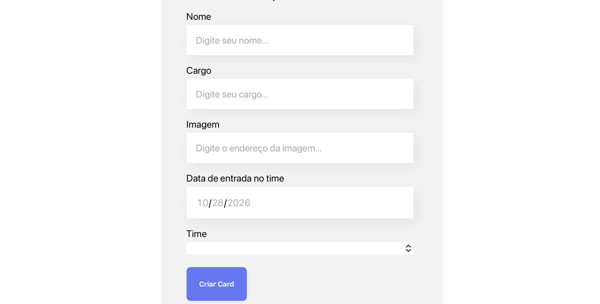

# Organo (TypeScript)

A small team-roster app built with React and TypeScript. You fill in a form with a name, role, photo URL, start date and team, and a card for that person appears under the right team's colored section. This is the third version of the project, and it moves the earlier JavaScript version to TypeScript.

> Built as hands-on practice while following an Alura course.

**Live demo:** [organo-v3.vercel.app](https://organo-v3.vercel.app)

| Home | Form |
|---|---|
|  |  |

## What's inside

- **Typed props and shared models.** Each component has its own props interface, and the collaborator shape is a shared `IColaborador` interface in `src/compartilhado/interfaces`.
- **Lifted state.** `App` owns the list of collaborators. The form reports new people up through a callback, and each team section receives only its own members, filtered by team name.
- **Controlled form.** Every field is a controlled input built from reusable `CampoTexto` and `ListaSuspensa` components. The required fields use the native HTML `required` attribute, and the start date uses a `date` input.
- **Teams as data.** Seven teams, each with a primary and secondary color, are defined once and used for both the dropdown and the section styling. A team with no members renders nothing.

The interface is in Portuguese.

## Stack

React 18, TypeScript 5, Create React App, plain CSS, deployed on Vercel.

## Run it locally

Requires Node.js 18 or newer.

```bash
git clone https://github.com/victorhubarb/organo-v3.git
cd organo-v3
npm install
npm start
```

Opens at `http://localhost:3000`.

## Project structure

```
src/
├── App.tsx                  State, team definitions, layout
├── compartilhado/interfaces/IColaborador.ts
└── componentes/             Banner, Formulario, CampoTexto, ListaSuspensa,
                             Botao, Time, Colaborador
```

## Known gaps

- Cards live in memory and disappear on reload.
- There is no way to edit or delete a card.
- The team dropdown's `itens` prop is typed as `string` although it receives a `string[]`, and the start date is not cleared after saving.
- Cards use the person's name as React `key`, so two people with the same name would collide.
- The layout has no media queries.
- A compiled `build/` folder is committed, which should be left to the host and ignored by git.
- No tests.

---

Victor Hugo Barbosa · [GitHub](https://github.com/victorhubarb) · [LinkedIn](https://www.linkedin.com/in/victorhbarbosa/)
